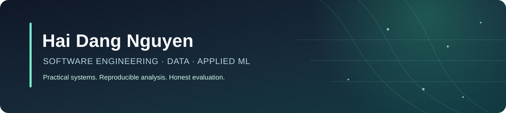

  

  
  
  

## About me

I'm an IT graduate interested in **software engineering, data analytics, and applied machine learning**. I like taking a problem beyond a notebook: understanding the data, building a reproducible pipeline, evaluating the results, and presenting them in a form people can use.

I value clear assumptions, reliable implementations, and honest evaluation. For decision-support systems, the goal is to help people make better-informed decisions - not to hide uncertainty or replace human judgment.

I'm exploring early-career opportunities across software engineering, data, and applied ML.

## Featured projects

<table>
  <tr>
    <td width="50%" valign="top">
      <h3><a href="https://github.com/haidangnguyen-cs/flight-delay-gnn-system">Flight Delay Prediction GNN</a></h3>
      
A flight-delay prediction proof of concept that models airport relationships with GATv2 and connects inference to a streaming data stack.

      
Graph Neural Networks · Kafka · Spark Streaming · Cassandra

    </td>
    <td width="50%" valign="top">
      <h3><a href="https://github.com/haidangnguyen-cs/smart-school-resource-planning">Smart School Resource Planning</a></h3>
      
An NCES-based analytical pipeline for enrollment and staffing trends, resource-pressure triage, and constrained state-level forecasting.

      
Data Engineering · Data Quality · Forecasting · Streamlit

    </td>
  </tr>
  <tr>
    <td width="50%" valign="top">
      <h3><a href="https://github.com/haidangnguyen-cs/student-at-risk-early-warning">Student Retention & Early Warning</a></h3>
      
An OULAD learning-analytics prototype for course-withdrawal risk, with a Day-35 feature cutoff, retrospective evaluation, subgroup audits, and human-reviewed support.

      
Learning Analytics · Predictive Modeling · Model Evaluation

    </td>
    <td width="50%" valign="top">
      <h3><a href="https://github.com/haidangnguyen-cs/chatgpt-openclaw-direct-tools">ChatGPT OpenClaw Direct Tools</a></h3>
      
A local MCP bridge exposing selected OpenClaw tools to regular ChatGPT for browser, desktop, file, and developer-workflow automation.

      
JavaScript · MCP · Browser Automation · Developer Tooling

    </td>
  </tr>
</table>

## Toolbox

  
  
  
  
  
  
  
  
  

## What I focus on

- **Build end-to-end:** from data validation and pipeline design to applications, reports, and usable interfaces.
- **Measure before claiming:** document assumptions, compare against baselines, and make limitations visible.
- **Keep people in the loop:** treat predictions as evidence for review, not automatic decisions.

---

  Always building, testing, and learning.

